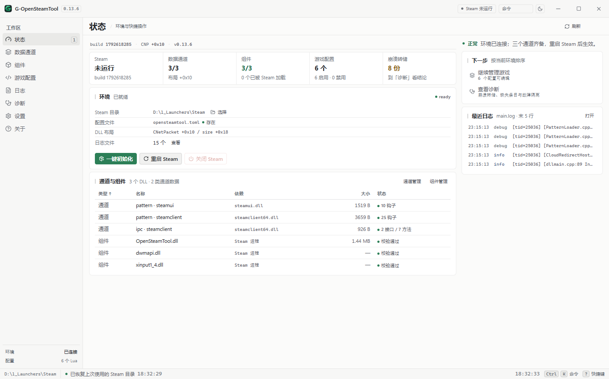
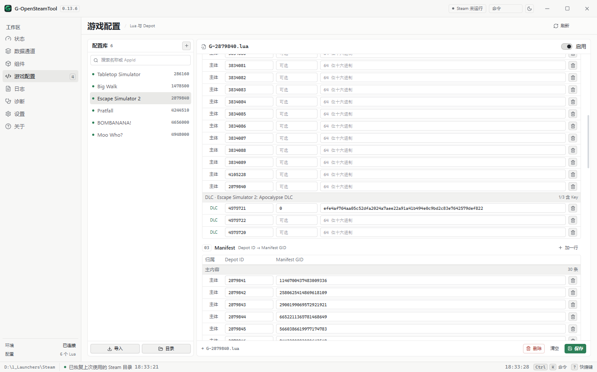
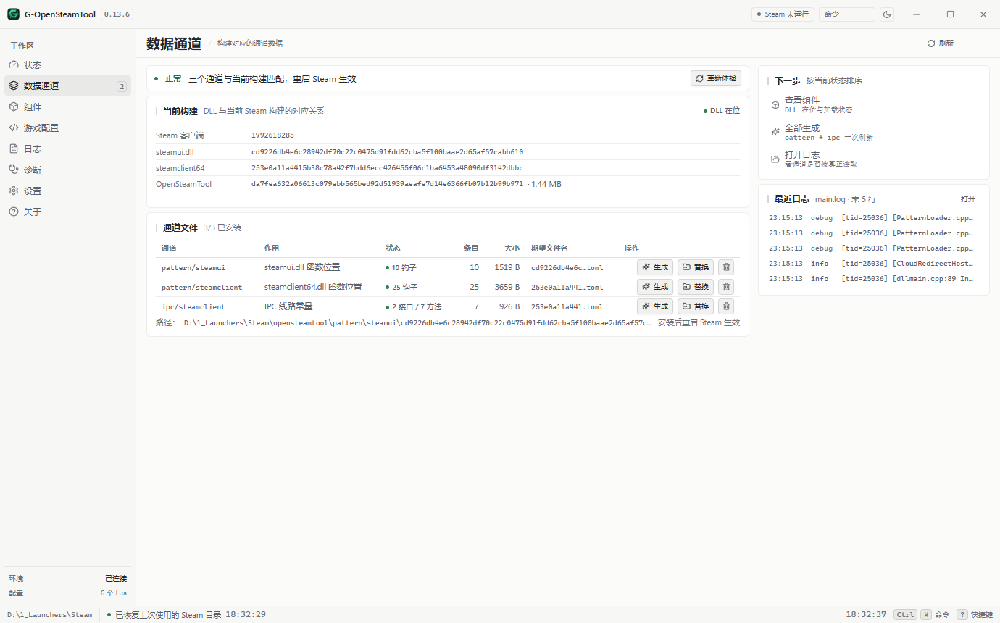

# G-OpenSteamTool

[](https://github.com/G-Yoka/G-OpenSteamTool/releases/latest)
[](https://github.com/G-Yoka/G-OpenSteamTool/releases)

Windows 上的 OpenSteamTool 桌面管理器：装组件、配游戏 Lua、生成数据通道、管下载通道、看日志，全在一个窗口里完成。

- 当前版本：**v0.13.6**
- 系统要求：Windows 10 / 11 x64
- 下载：[GitHub Releases](https://github.com/G-Yoka/G-OpenSteamTool/releases/latest)（便携单文件，DLL 已内嵌）

> 本工具只做本地管理与配置整理，不编译 OpenSteamTool 上游源码，也不会生成、猜测或联网获取账户本地不存在的 Depot Key。

## 界面预览

浅色是默认主题，标题栏可切换深色并记住选择。







## 功能

**开箱即用**

- 自动找到 Steam 目录，也可手动选择包含 `steam.exe` 的文件夹，下次启动自动恢复。
- 「一键初始化」一次做完：安装托管组件、写入默认 `opensteamtool.toml`、生成当前 Steam 版本对应的通道文件。
- 组件页显示 `OpenSteamTool.dll`、`dwmapi.dll`、`xinput1_4.dll` 的安装与加载状态；只删除本工具装过且哈希匹配的文件。

**游戏配置**

- 按 `G-<AppId>.lua` 管理配置：新建、编辑、启用 / 禁用、批量导入、删除。
- 「本地自动获取」从本机 Steam 缓存里补齐 Depot、Manifest 与已有的 Depot Key，不需要手抄。
- DLC 一并处理：自动列出该游戏的 DLC，标出哪些本地已有内容，勾选即写入。
- 已保存的配置按「主体 / DLC」分组显示，长列表也能一眼分清归属。
- 重新获取只补空、不覆盖：手里已有的 Key、Manifest 不会被清掉。

**通道与下载**

- 数据通道页按当前 Steam 版本管理 `pattern` / `ipc` 三个文件，缺失或过期会直接说明；Steam 更新后点「全部生成」即可。
- 下载通道页可写入 / 更新 / 移除 `manifest.lua`，并自带自检：显示取码服务的 HTTP 状态、耗时与清单大小，跟随你的下载区域选择节点。

**诊断**

- 崩溃转储、缺失条目、被抑制异常集中展示，并把崩溃位置归因到 DLL 还是 Steam 侧。
- 运行日志按级别与关键字筛选；遇到「无互联网连接」可用[诊断脚本](tools/collect-diagnostics.ps1)一键收集。
- 后台线程安全关闭 / 重启 Steam，界面不卡、不重复启动。

**操作**

- `Ctrl K` 命令面板；`Ctrl 1…8` 切换页面；`Ctrl R` 刷新；`Ctrl F` 搜索；`Ctrl ⇧ L` 切换主题；`?` 查看快捷键。

## 下载与安装

1. 到 [Releases](https://github.com/G-Yoka/G-OpenSteamTool/releases/latest) 下载 `g-opensteamtool.exe` 与 `SHA256SUMS.txt`。
2. 完全退出 Steam。
3. 把 EXE 放到任意独立目录运行（不要放进 Steam 根目录），无需安装。

校验下载：

```powershell
Get-FileHash .\g-opensteamtool.exe -Algorithm SHA256
Get-Content .\SHA256SUMS.txt
```

详细说明见 [安装、升级与卸载](docs/INSTALL.md)。

## 快速开始

1. 启动工具，确认顶部显示的 Steam 目录是否正确（不对就点「选择」）。
2. 点「一键初始化」。
3. 打开「游戏配置」，输入游戏 App ID，点「本地自动获取」。
4. 在「主内容 / DLC」里核对条目，勾选要启用的 DLC，保存。
5. 重启 Steam 生效。

以后 Steam 大版本更新，只需要到「数据通道」点一次「全部生成」，再重启 Steam。

## 常见问题

**游戏明明有 DLC，工具却只列出一个或一个都没有？**
工具只读取本机 Steam 缓存（`appinfo.vdf`）。商店页有、但本地没缓存的 DLC 不会凭空出现——在 Steam 里打开该 DLC 的商店页停留一下，让客户端缓存后，再点一次「本地自动获取」。

**DLC 分组写着「含 Key」，可 AppId 那一行是空的？**
Key 属于 DLC 的**内容 Depot 行**（例如 `4575721`），不在 DLC 的 AppId 行（`4575720`）上。分组条右侧的 `x/y 含 Key` 就是这一组的实际数量。

**重新点「本地自动获取」，我填好的 Key 会丢吗？**
不会。发现结果只补空位，已有 Key、解锁标记与 Manifest 都会保留。

**组件页显示「未加载 · 备用」是不是坏了？**
不是。只有 `OpenSteamTool.dll` 必须进入 Steam 进程；另外两个是代理加载器，哪条通道被触发取决于本次启动环境。

**Steam 更新后游戏打不开 / 下载失败？**
先到「数据通道」点「全部生成」，重启 Steam。下载报「无互联网连接」见[这份排查说明](docs/NO_INTERNET.md)。

**工具会联网上传我的配置吗？**
不会。Depot Key 只在本地读取和写入，不写日志、不上传；工具本身没有应用内更新或遥测。

## 使用边界

- 只操作自己安装的组件与 `G-*.lua` / `G-*.lua.disabled`，不改动其他文件。
- 所有写入采用临时文件 + 回滚，避免中途失败留下半截文件。
- 不提供 Depot Key 的生成或联网获取；本地没有就是没有。
- 使用前请确认符合所在地区法律与 Steam 协议，配置与结果由使用者自行负责。

## 从源码构建

需要 Node.js、Rust MSVC 工具链与 Visual Studio Build Tools（Desktop development with C++）。

```powershell
cd app
npm ci
npm run build
npm run build:tauri-release
```

产物：`app/src-tauri/target/release/g-opensteamtool.exe`

## 仓库结构

```text
G-OpenSteamTool/
├── app/                 Tauri 应用（React 前端 + Rust 后端）
│   ├── src/
│   └── src-tauri/
│       ├── src/
│       ├── resources/   内嵌的 DLL 与 IPC 定义
│       └── icons/
├── docs/                安装说明、更新记录、故障排查
├── tools/               诊断脚本
├── screenshots/         界面截图
└── README.md
```

## 文档

- [安装、升级与卸载](docs/INSTALL.md)
- [版本更新记录](docs/CHANGELOG.md)
- [「无互联网连接」排查](docs/NO_INTERNET.md)

## 说明

G-OpenSteamTool 是非官方社区项目，与 Valve、Steam 或 OpenSteamTool 上游作者没有隶属关系。
