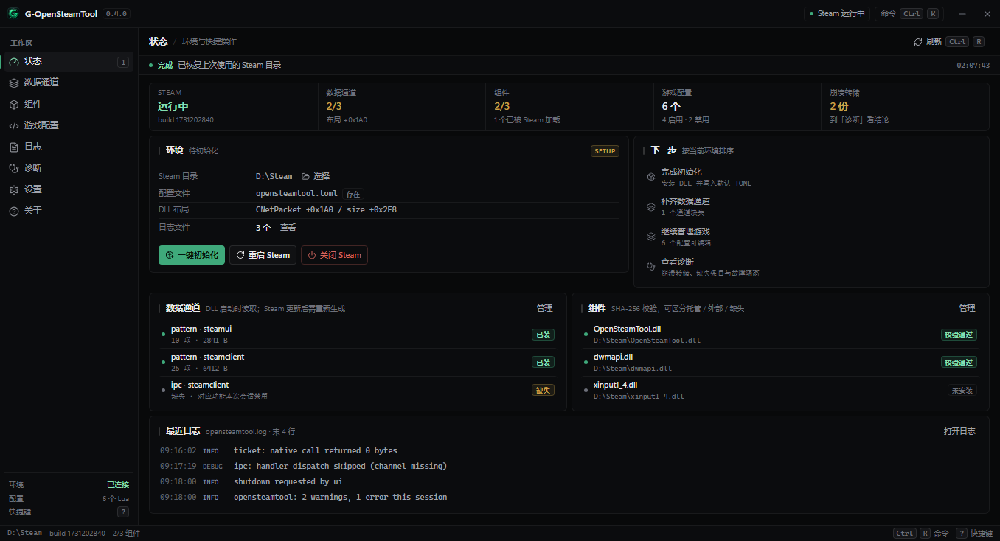
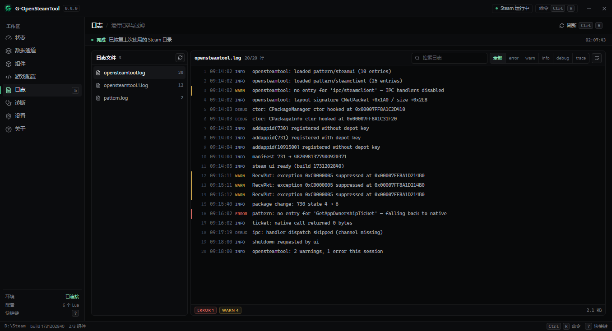
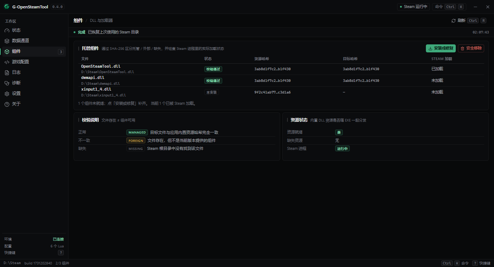
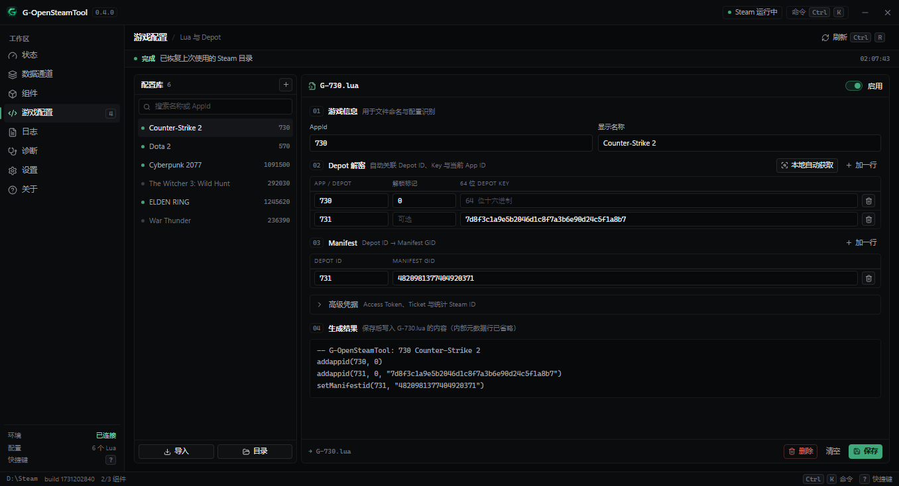
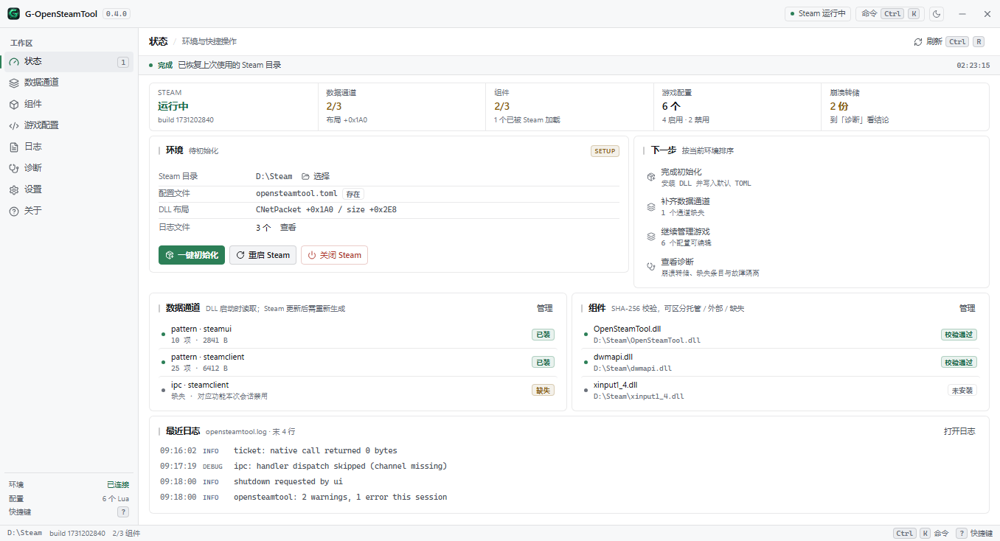
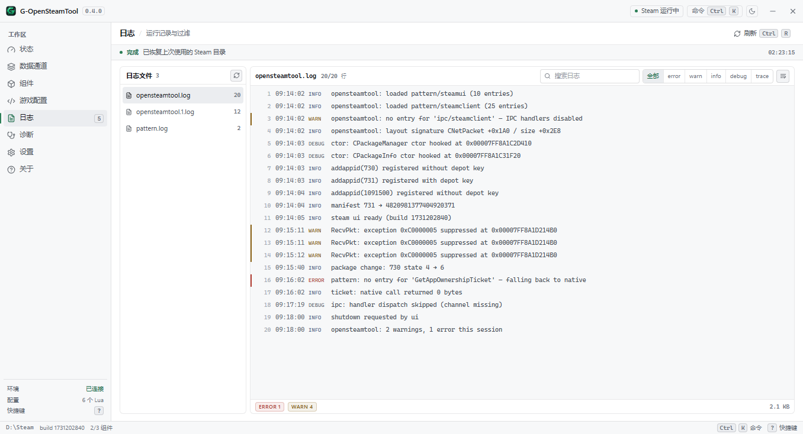

# 界面设计规范（v0.4）

> 一句话基调：**Linear 的克制配色 + Raycast 的键盘感**。
> 优先级固定为 **① 信息密度 → ② 辨识度 → ③ 动效**；任何改动与这三条冲突时，按顺序让步。

参考截图（1380×860 默认窗口，深色）：

| 概览 | 日志 |
| --- | --- |
|  |  |

| 组件 | 游戏配置 |
| --- | --- |
|  |  |

浅色主题（同一套结构，只换 token）：

| 概览 | 日志 |
| --- | --- |
|  |  |

## 0. 主题：一套 token，两套取值

`<html data-theme="dark|light">` 是唯一开关，组件完全不感知主题（`app/src/app/useTheme.ts`）。

- 取色优先级：`localStorage.gost.theme` → 系统 `prefers-color-scheme`；首帧前在 `main.tsx` 落好属性，避免闪白/闪黑。
- 切换入口：标题栏右侧图标按钮、命令面板「切换到浅色/深色主题」、快捷键 `Ctrl ⇧ L`。
- 新增颜色时**两套都要给值**，且必须通过对比度检查（小字号 ≥ 4.5:1）。

| 语义 | 深色 | 浅色 |
| --- | --- | --- |
| `--bg` 画布 | `#08090a` | `#fafbfc` |
| `--panel` 卡片 / 面板 | `#0b0c0e` | `#ffffff` |
| `--chrome` 标题栏 / 导航 / 状态栏 | `#0b0c0e` | `#f4f6f8` |
| `--overlay` 命令面板 / 快捷键表 | `#151619` | `#ffffff` |
| `--raise` `--raise-2` `--raise-3` | `#101113` `#151619` `#1b1d21` | `#f3f4f6` `#eaecef` `#dfe2e7` |
| `--field` 输入框 | `#08090a` | `#ffffff` |
| `--code-bg` 代码 / 日志正文 | `#08090a` | `#f7f8f9` |
| `--line` `--line-2` `--line-3` | 白 6/10/16% | 黑 10/16/24% |
| `--fg` `--fg-2` `--fg-3` | `#e9eaec` `#a1a4ac` `#7b7f88` | `#14161a` `#4a5058` `#626870` |
| `--accent` / `--on-accent` | `#3fa97b` / `#04140d` | `#2c7f57` / `#ffffff` |
| `--accent-fg` 强调文字 | `#84dfb2` | `#1c6b4a` |
| `--warn` `--danger` `--info` | `#c9a24a` `#d3675f` `#808da6` | `#8a6114` `#b0392e` `#47618a` |

浅色不是「深色反相」：画布压到 `#fafbfc`、卡片留纯白，靠 `.10` 起的描边分层；外壳再压一档到 `#f4f6f8`，形成"纸面 + 灰边"的窗口感。浅色下 `--shadow-inset: none`，避免高光把卡片顶出一层假立体。

## 1. 配色：只留一支强调色

所有颜色都来自 `app/src/app/theme.css` 顶部的 CSS 变量，组件里不允许出现新的色值。

| 变量 | 深色值 | 用途 |
| --- | --- | --- |
| `--bg` | `#08090a` | 应用底色 |
| `--panel` | `#0b0c0e` | 卡片 / 面板 |
| `--chrome` | `#0b0c0e` | 标题栏 / 导航 / 状态栏 / 通知条 |
| `--raise` `--raise-2` `--raise-3` | `#101113` `#151619` `#1b1d21` | 悬停、选中、按压三档表面 |
| `--line` `--line-2` `--line-3` | 白 6% / 10% / 16% | 描边三档，**层次只靠描边和表面明度** |
| `--fg` `--fg-2` `--fg-3` | `#e9eaec` `#a1a4ac` `#7b7f88` | 正文 / 次要 / 弱化 |
| `--accent` `--accent-fg` | `#3fa97b` `#84dfb2` | 唯一强调色：主操作、当前导航、聚焦环、正向状态 |
| `--warn` `--danger` `--info` | `#c9a24a` `#d3675f` `#808da6` | 状态提示，永远以「小面积标记」出现 |

硬规则：

- 不用渐变背景、不用发光阴影、不用 12px 以上圆角（`--r: 6px`，`--r-lg: 8px`）。
- **强调色预算**：每屏可见的 accent 文字/面 ≤ 4 处，且只允许出现在主按钮、active rail item、focus 环、
  一个指标数字（`.metric.focus`）。其余状态一律「中性灰 + 5px 状态点」，点不算预算。
- 状态用 `Badge`（灰字 + 5px 点，16px 高）表达，不用彩色胶囊或整行背景。


## 2. 密度：尺寸守恒

| 元素 | 尺寸 |
| --- | --- |
| 控件高 `.btn` / `.input` | 26px（`--h-ctl`），`.btn-sm` 22px |
| 列表行 `.list-row` / `.g-item` | 28px（`--h-row`） |
| 表格行 | 27px，表头 24px |
| 日志行 | 21px，等宽 10px |
| 字号 | 按文字类型分档：`--fs-page 19` / `--fs-num 15` / `--fs-body 12` / `--fs-table 11.5` / `--fs-meta-cjk 11`（中文元信息）/ `--fs-meta 10`（等宽数字、时间戳、键帽、表头、badge） |
| 卡片内边距 | `9px 12px 10px`，卡片间距 6px |

字号不再承担层次：同一段信息里，主/次/弱分别用 `--fg` / `--fg-2` / `--fg-3` 区分。

信息密度靠**结构**换，不靠缩字号：

- 指标用 `.metrics` 一条横向铺开（`--line` 竖线断句），替代四张独立卡片。
- 事实用 `.kv`（左列 132px 定宽），替代一堆小卡片。
- 多对象对比用 `.table`，一行一个对象，状态在最右列。
- 页面内不留「装饰性留白」；空出来的区域放**真实信息**（如概览页的最近日志、游戏页的生成结果预览）。

## 3. 键盘：每个动作都有按键路径

- `Ctrl K` 命令面板：页面跳转 + 环境/组件/数据操作统一入口，支持 ↑↓ 选择、↵ 执行、`esc` 关闭、输入即过滤。
- `Ctrl 1…8` 直达左侧导航。
- `Ctrl R` 刷新全部状态；`Ctrl F` 聚焦当前视图搜索框；`Ctrl ⇧ L` 切换明暗主题；`?` 打开快捷键表；`Esc` 关闭浮层。
- 按钮上的快捷键用 `.kbd` 键帽标出（标题栏「命令 Ctrl K」、页面头的「刷新 Ctrl R」、导航行右侧数字）。
- 光标的落点必须可见：`:focus-visible` 统一为 1px 强调色描边 + 1px 偏移。
- 新增可点击操作时，同步在 `AppShell` 的 `commands` 里登记一条命令（含 `keywords`，便于模糊搜索命中）。

## 4. 动效：只做状态确认

- **可扫读的密集行不做过渡**：`.list-row / .table tr / .rail-item / .act-row / .g-item / .seg button / .btn / .icon-btn`
  一律 `transition: none`，鼠标扫过即时变色，不留拖影。
- 过渡只留给浮层：`.palette-scrim / .palette / .sheet` 保留 `opacity 120ms ease-out`。
- 不允许位移、缩放、旋转、视差、骨架屏闪烁。
- `prefers-reduced-motion: reduce` 时全部关闭（仅保留刷新图标的旋转）。
- 字体平滑保持 `auto`：`antialiased` 会在 WebView2 里关掉 ClearType，12px 中文发虚而等宽数字仍锐利。

## 5. 浏览器预览数据

`app/src/app/preview.ts` 提供一套固定演示数据，仅在**没有 Tauri 运行时**（`npm run dev` 直接用浏览器打开）时生效，用来校对密度与键盘路径。

- 打包后的 EXE 一定带 `__TAURI_INTERNALS__`，不会读到这些假数据。
- 预览里三个通道、3 个 DLL、6 个配置、3 份日志分属不同状态，覆盖 ok / warn / bad 三种样式。

## 6. 页面骨架：满高双栏 + 结论先行

状态 / 组件 / 诊断三页用 `.page-split`：左主内容 `minmax(0,1fr)`、右侧栏固定 320px、`height:100%`、`gap:10px`。

- **左列**：结论块 → 主卡片（表格/键值）→ 次卡片，全部自然高度（`align-items: start`），
  不再把余高等分进卡片——空白留在页面背景里，而不是被边框框成"两张空卡"。
- **右列**（顺序固定）：① 结论句块（`.verdict.stacked`）② 下一步 / 待处理列表（`.act-row`）③ 最近日志尾 5 行（mono、单行省略、只读）。
- 日志页保持左右双栏，只在顶部多一条跨栏结论。
- 窄窗（≤1080px）两列退化为单列，滚动交还 `.content`。

**结论先行**（`.verdict`）：每个数据页在表格上方先给一句判断 + 一个动作，明细在后。

- 句子必须由真实数据生成（崩溃归因、组件通过数、日志 warn/error 计数），不写死文案。
- 崩溃表把长结论压成 `+0xOFFSET` + 状态点，完整解释进 `title`；hash 列中间省略（前 12 + … + 后 6），`title` 留全文、单击复制。

## 7. 可选文本与可发现性

- 正文默认可选（`body { user-select: text }`）；`.rail / .titlebar / .btn / .badge / .table th / .toggle` 不可选，避免拖拽误选。
- 日志正文、`.code`、`.table code`、`.kv code`、`.statusbar .path` 可选中复制，光标为文本；`.hash` 是例外——单击即复制全文，因此不可选。
- 成功类 notice 3 秒后自动收起（整条移除，不留空行）；working / error 常驻。收起后不再往状态栏复制一份。
- 导航行快捷键：hover / 当前项 / **按住 Alt** 三种时机显示。
- 带快捷键的按钮统一写 `data-kbd="Ctrl R"`，由 `::after` 在 hover / 聚焦时渲染 10px kbd 小字，不额外占位。

## 8. 结构速查

```text
titlebar 38px      品牌 · 版本 · 连接状态 · 命令面板入口 · 主题开关 · 窗口按钮
body
├── rail 188px     主导航（图标 + 名称 + 快捷键数字），底部环境摘要
└── main
    ├── page-head 38px   标题 / 面包屑 / 页内动作
    ├── notice 26px      全局状态条（成功后 3 秒收起）
    └── content          页面正文
        └── page-split   左主内容 + 320px 侧栏（状态 / 组件 / 诊断）
statusbar 22px     Steam 目录（中省略）· 当前时间 · Ctrl K / ? 提示
```
## 9. 文案：三层，两条硬规则

界面只回答「我现在什么状态 / 下一步点哪里」，机制一律下沉。

| 层 | 位置 | 内容 | 长度 |
| --- | --- | --- | --- |
| 常显 | `CardHead sub` / `Verdict` / `note` | 状态 + 动作 | ≤ 12 字 |
| 悬浮 | `title=` | 一行机制说明 | 一行 |
| 文档 | `docs/`（如 [PATTERN.md](PATTERN.md)） | 完整因果、命令行、术语表 | 不限 |

硬规则：

- **解释预算**：每页 `note` ≤ 1 条，且必须是「不做就出错」的行动提示（例：「DLL 不在位，先安装」）；纯知识类为 0。
- **不重复层**：一个结论不允许同时出现在 `CardHead sub`、表格 Badge、`note`、右侧栏四处，只留最靠近操作的那一层。

术语：界面用中文状态词（校验通过 / 版本不一致 / 未安装），原始标识（`Managed`、`CNetPacket`、`url_template`）只出现在 `<code>`、`title` 和文档里。